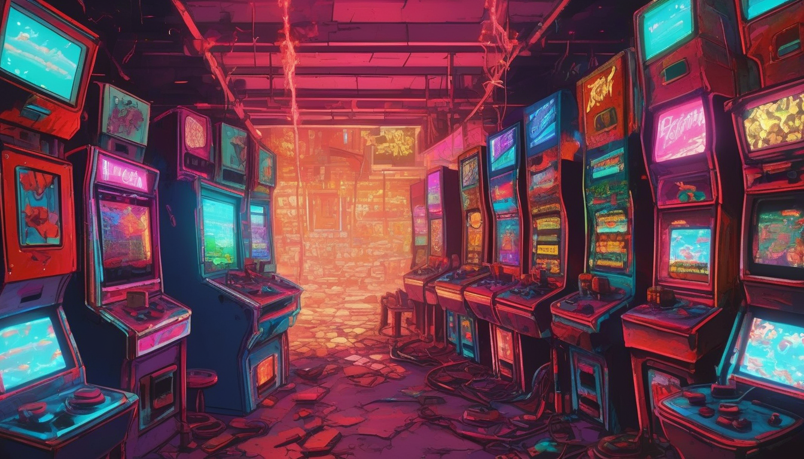
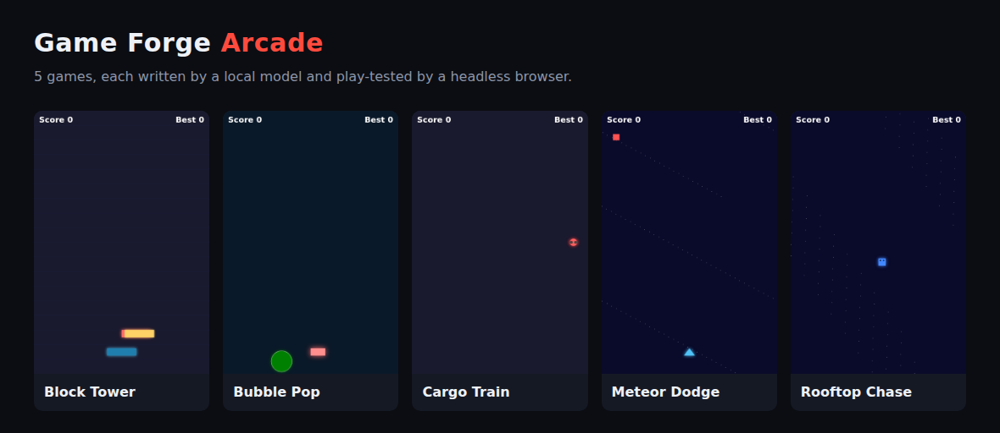

# game-forge

**One line of idea in. One playable browser game out. Written by a model on your own machine and play-tested before you ever open it. Free.**

There's a post going around: two programmers, about a hundred games a month, all written by AI.
The pipeline behind that isn't a secret, so here it is.

**[Play the five example games in your browser →](https://warboy176.github.io/game-forge/games/)**



## What it does

- **Writes the game.** You give it an idea, like *"dodge falling meteors with a tiny spaceship"*. A
  language model writes the game logic into a fixed engine that already handles the canvas,
  keyboard and touch input, score, best score, game over and restart.
- **Plays it before you do.** Every game is loaded in a headless browser and mashed with keys and
  taps for five seconds. Does it parse? Does the loop run? Does anything move? Is the screen blank?
  Does the player die before touching anything? Any errors?
- **Fixes its own mistakes.** A game that fails goes back to the model with the exact error and the
  line it happened on, for up to three repair rounds.
- **Builds the arcade.** `games/index.html` lists every game that passed, with a screenshot of each.
  Upload the `games` folder to GitHub Pages, itch.io or any static host.

Each game is a single self-contained HTML file. No assets, no build step, no server, and it plays
on a phone.

## Run it

```bash
git clone https://github.com/warboy176/game-forge
cd game-forge
pip install -r requirements.txt
playwright install chromium        # the browser the play-test uses
python forge.py "dodge falling meteors with a tiny spaceship"
```

Then open `games/index.html`.

More than one at a time:

```bash
python forge.py --batch ideas.txt                 # one game per line of the file
python forge.py --invent 10 --theme "deep sea"    # the model pitches the ideas too
```

## Pick a model

Any OpenAI-compatible endpoint works. The default is a local [Ollama](https://ollama.com):

```bash
ollama pull qwen2.5-coder:14b
python forge.py "..."                                  # http://localhost:11434/v1

FORGE_MODEL=qwen3-coder:30b python forge.py "..."      # a bigger local model

# llama.cpp server, LM Studio, vLLM or a hosted API:
FORGE_ENDPOINT=http://host:port/v1 FORGE_MODEL=<model> FORGE_API_KEY=<key> python forge.py "..."
```

The example games in `games/` were written by `qwen3-coder:30b` running on one local GPU. All
five ideas in `ideas.txt` passed the play-test; four of them failed it first (one syntax error,
three drew their own score over the engine's) and fixed themselves in one repair round. Each game
took between 35 and 76 seconds, start to finish.

## What it is not

- **Not a hit factory.** These are small one-screen arcade games. The model writes games that work;
  whether anybody plays one twice is still your job.
- **No ads, analytics or tracking built in.** If you want to monetise, that part is yours to add,
  and nothing here promises it will earn anything.
- **The play-test proves a game runs and reacts to input. It does not prove the game is fun.**

## The honest limits

- Smaller models fail more often and lean on the repair loop. Below about 7B parameters, expect a
  lot of retries.
- The engine is a 480x720 portrait canvas. Want sound, sprites or levels? Extend `template.html`
  and describe the new parts in `prompt.md`; the model only knows what that file tells it.
- The play-test needs Playwright and a Chromium download. `--no-check` skips it, at the cost of
  shipping games nobody has run.

## Forge Pro (V2)

The paid upgrade adds sound and music, screen shake and particles, levels, a quality score for
every game, an overnight factory that keeps only the best, and upload-ready builds with covers and
store listings for itch.io, Poki and CrazyGames.
**[Forge Pro on Patreon →](https://www.patreon.com/warboy176/posts/forge-pro-v2-and-175203298)**

This free version stays free.

## How it fits together

| File | Job |
|---|---|
| `forge.py` | idea → model → engine → play-test → repair loop |
| `template.html` | the engine every game runs inside |
| `prompt.md` | the rules the model writes to |
| `check.py` | the headless play-test |
| `gallery.py` | builds `games/index.html` |

---

Built by Warboy. Free, and it stays free.
